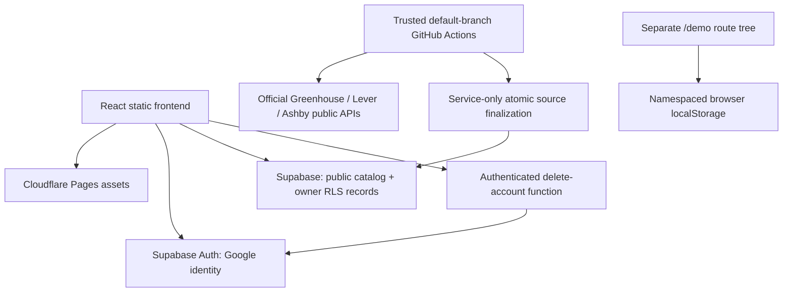

# Architecture

MSBA Shortlist is a static React/TypeScript Vite application with three primary routes: Opportunities, My Search and lazy-loaded Insights. React Router handles navigation, TanStack Query caches server state, Zod validates boundaries, and Radix dialog primitives/Tailwind styles support the interface. System fonts and local assets avoid an external font dependency.

## Shared domain and repositories

`src/domain` contains pure matching, ranking, dates, tasks, analytics, transfer and record functions. Both repositories implement `src/repositories/types.ts`. The demo repository uses deterministic fictional fixtures, relative dates and versioned localStorage. The live repository uses the actual Supabase client and SQL RPCs; an unconfigured/failed live service returns a clear error and a link to the separate demo. Demo data never becomes a production fallback or automatically merges into an account.

The repository reads compact catalog pages before client ranking and fetches descriptions on demand. A visible 5,000-summary cap bounds the pilot; total/truncation are explicit. Private records paginate independently so exports do not silently stop at the API's row maximum. Catalog updates and private editable fields/snapshots are separate data paths.

## Authentication and private mutations

Browser OAuth uses Google basic identity only with PKCE. The frontend callback exchanges a one-time code through a shared in-flight promise and then validates the user. Query keys include account identity; account changes clear private caches and drafts. RLS is the authorization boundary, with composite parent/owner FKs and immutable owners providing database-level protection.

Private saves and stage changes use transactional owner-checked RPCs because arbitrary event/stage writes are revoked. Events retain historical interview/offer milestones and distinguish opening a page from submitting an application. Imports validate and preview, then atomically remap all ownership and parent IDs. Self-service deletion is the sole required Edge Function: it independently verifies the bearer token and deletes only the verified user's Auth account, cascading private records.

## Discovery pipeline

`data/employers.json` records provider/board identity, official evidence and usage review. Node/TypeScript adapters use supported public APIs with bounded concurrency, timeouts and retries. Normalization/classification is conservative and explainable; unknown US/full-time evidence stays unknown and appears only when requested. Source URLs and publication/update/discovery/verification timestamps remain distinct.

The ingestion CLI obtains the complete valid board snapshot and calls one service-only finalizer. A source row lock and run key make publication concurrent-safe and repeatable. Incomplete/failed/malformed or suspiciously reduced snapshots cannot close jobs. Closure requires two complete absences separated by at least 12 hours; private application stages never change. Freshness depends on actual complete successful checks. Safe coverage aggregates are public while run diagnostics remain server-only.

## Operations and tradeoffs

Cloudflare Pages serves static assets, Supabase supplies identity/Postgres/function hosting, and trusted GitHub Actions refreshes public feeds. No custom server, LLM API, SMTP, scraping browser, ORM, Realtime fan-out or paid monitoring is introduced. The target is a small pilot within provider free allowances, not unlimited capacity. Maintenance prunes obsolete run logs and unreferenced closed details after at least 90 days while preserving private snapshots/history.

The shared client ranking engine needs a practical catalog bound; larger coverage needs measured server filtering/pagination and reviewed indexes without inventing a second opaque ranking engine. Real OAuth, REST isolation and deployed deletion checks require owner credentials and deployment. Local PostgreSQL WASM smoke tests supplement the Docker-based Supabase/pgTAP suites; neither is represented as a live deployment. See `DATABASE.md`, `SECURITY.md`, `DEPLOYMENT.md` and `TEST_REPORT.md`.

## Follow-up validation — October 21, 2026

The public source repository is [blucat1/msba-shortlist](https://github.com/blucat1/msba-shortlist). [GitHub Actions run 39568999347](https://github.com/blucat1/msba-shortlist/actions/runs/39568999347) passed for commit `1df3e1590346616c40b65f75b7dadd8553e946d1` and completed at **01:27:08 PDT** (**08:27:08 UTC**). Its application job passed lint, strict typecheck, 75 unit tests, 93 WASM assertions, the static build and six Chromium browser workflows. Its [Supabase authorization job](https://github.com/blucat1/msba-shortlist/actions/runs/39568999347/job/119118184024) started the real disposable Docker-based Supabase stack and passed **93 pgTAP tests across two SQL suites** before stopping the stack.

The SQL deployment/test architecture has therefore been exercised on the GitHub runner despite Docker being unavailable during the initial Mac build. This was a test stack, not the hosted production database or a live catalog import. Hosted Supabase/Google OAuth, two real users through REST/RPC, Pages configuration and deployed account deletion remain separate owner deployment/acceptance work. See [TEST_REPORT.md](TEST_REPORT.md) for dated evidence and limits.
